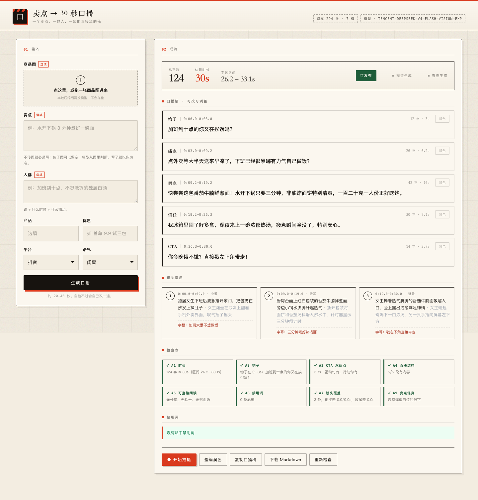

# Selling Point → 30-Second Script

**English** · [简体中文](README.zh-CN.md)

Turn one selling point and one audience into a script you can read straight into the camera: five beats with per-line timing, three shot cards, and a compliance report that actually checks something.

Runs locally. No deploy, no build step, no dependencies.



## Quick start

```bash
cp .env.example .env    # fill in LLM_BASE_URL / LLM_MODEL / LLM_API_KEY
node server.js
```

Open <http://127.0.0.1:3030>.

**No API key?** It still runs. You get a template fallback script, clearly labelled as such in the UI. Nothing breaks.

## The five beats

30 seconds only fits one idea. The structure is fixed so the model can't wander:

| Beat | id | Target | Job |
|---|---|---|---|
| Hook | `hook` | 0–3s, ≤ 12 chars | Name the audience, or name what they lose |
| Pain | `pain` | ~5s | The moment they feel it, in their words |
| Selling point | `selling_point` | ~11s | One claim, with a number |
| Proof | `trust` | ~6s | Why believe it |
| CTA | `cta` | ~4s | Interaction line, then action line |

## The checks

Every deliverable is scored before you see it. Green means publishable; red means the model gets one more shot at that paragraph.

| # | Check | Rule |
|---|---|---|
| A1 | Duration | 27–33s. Chars ÷ 4.4/s + 0.25s per sentence break |
| A2 | Hook | Inside 3.5s, names the audience or a loss |
| A3 | CTA double-beat | Last block ≤ 6.5s, interaction line **and** action line |
| A4 | Five beats | All five present |
| A5 | Readable aloud | Clause ≤ 20 chars, no brackets, no written-Chinese connectives, no Latin acronyms |
| A6 | Banned words | Zero `block` hits; `review` hits get an evidence prompt |
| A7 | Shot coverage | Three shots, back to back, covering the whole timeline |
| A9 | Claim fidelity | No numbers the model invented |

A6 is deliberately **not** "zero hits". The lexicon has three dispositions — `block`, `review`, `warn` — because "pure natural" or "0 sugar" can't simply be banned; they have to be substantiated.

## How it works

```
input → selling-point gate → model draft → self-check
      → only failing beats are sent back for a rewrite → deliver
```

- **Generation and checking are separate.** The model writes; the checker judges.
- **Targeted rewrite.** Only the red paragraph goes back to the model. Passing paragraphs are untouched.
- **Abort on disconnect.** Close the tab and the in-flight request is cancelled. One generation at a time, so the gateway never gets hammered.

## Beyond the script

### Photo → script

Drop in a product photo (click or drag). The browser downscales it to a 768px JPEG (~40KB) before sending.

- Selling point can be empty — the model reads the pack.
- If you do write one, yours wins; the photo is only context.
- A9 is the backstop: a number in the script that isn't in your brief or the photo gets flagged.

### Polish

- **Per beat** — the small button on each card. Only that beat changes.
- **Whole script** — one pass over all five.

The prompt forbids touching numbers or adding claims, and the server re-measures length: if a beat drifts more than 15%, it is reverted and you're told which one. Better a no-op than a silent 30 → 40 second script.

### Teleprompter

"Start shooting" opens a dark, full-screen `/shoot.html`:

- Mirrored camera preview, phone-first
- 3-2-1 countdown, then recording starts and the script scrolls
- Scroll speed = text height ÷ script duration, so a 30s script takes 30s to read
- Space start/stop · ↑↓ speed (live) · Esc exit
- Download as `.webm`

The prompt text is **not** burned into the video — it's for your eyes only. Camera needs `127.0.0.1` or https.


## Configuration

| Variable | Meaning |
|---|---|
| `LLM_BASE_URL` | Any OpenAI-compatible gateway, e.g. `http://host/v1` |
| `LLM_MODEL` | Deployment name |
| `LLM_API_KEY` | Key. Lives in `.env` only, which is gitignored |
| `PORT` | Defaults to 3030 |

## Layout

```
data/banned.json   294 entries · 7 levels · 3 dispositions
lib/timing.js      speech-rate and timing model
lib/banned.js      normalise → longest match → whitelist → single-char audit
lib/check.js       A1–A9
lib/gate.js        the four selling-point gates
lib/prompt.js      generation, repair and polish prompts
lib/llm.js         OpenAI-compatible client (retry / timeout / JSON repair)
lib/fallback.js    deterministic script when there's no model
server.js          HTTP server + generation orchestration
web/               single-page UI + teleprompter
test/              smoke test
scripts/           screenshot tooling (dev only)
```

## Testing

```bash
node test/smoke.mjs
```

Golden sample: 118 chars / 28.6s / A1–A9 all green.

Screenshots (dev only, server must be running):

```bash
npm i -D playwright-core          # once
node scripts/shots.mjs design     # pack | design | shoot | record | image
```

## Design

Paper, ink, vermilion. A clapperboard, not a SaaS dashboard.

- Serif headline for Chinese, monospace for every number
- Paper grain, 44px grid, noise overlay
- Vermilion appears three times only: the section dot, the timeline, the shoot button
- Hard borders with 6px offset shadows — sheets pinned to a wall

## Limitations

- Catches explicit violations, not insinuation. "I haven't had a cold in three years" is beyond a word list.
- Platform rules drift; audit the L5 diversion list quarterly.
- Timing is an estimate — real speech varies ±15%, which is why we report a range, not a number.
