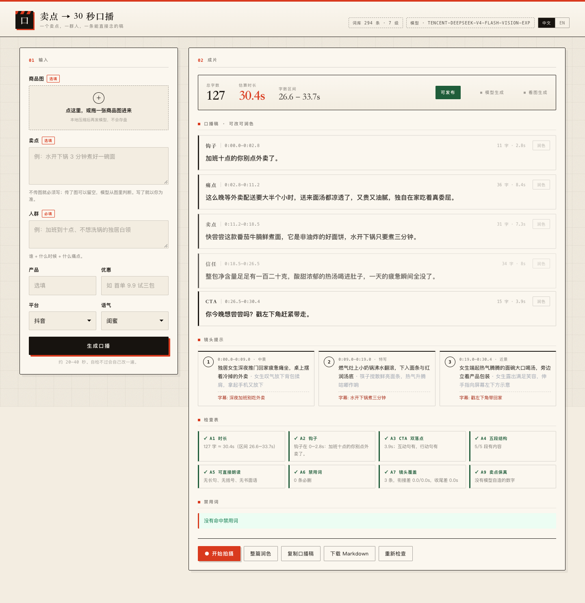

# 卖点 → 30 秒口播

[English](README.md) · **简体中文**

输入一个卖点、一群人，产出一条能直接对着镜头念的口播：五段带时间码的稿子、三张镜头卡、一份真的会拦人的合规检查。

本地跑，不部署、不打包、零依赖。界面右上角可切中英文——稿子本身仍然是中文，那是要念出来的东西。



## 快速开始

```bash
git clone https://github.com/xinpengfei520/koubo-script.git
cd koubo-script
cp .env.example .env    # 填 LLM_BASE_URL / LLM_MODEL / LLM_API_KEY
node server.js
```

打开 <http://127.0.0.1:3030>。

**没填 key 也能跑**：会走本地模板兜底稿，界面明确标注「模板兜底」，功能不中断。

## 五段结构

30 秒只装得下一件事。结构写死，模型不能自由发挥：

| 段落 | id | 目标时长 | 任务 |
|---|---|---|---|
| 钩子 | `hook` | 0–3 秒，≤ 12 字 | 点名人群，或点名损失 |
| 痛点 | `pain` | 约 5 秒 | 用他们的话说那个瞬间 |
| 卖点 | `selling_point` | 约 11 秒 | 一个主张，带数字 |
| 信任 | `trust` | 约 6 秒 | 凭什么信 |
| CTA | `cta` | 约 4 秒 | 先互动句，再行动句 |

## 检查项

每条交付都要过闸。全绿才算可发布，红了就把那一段退回去重写一次。

| # | 检查 | 判据 |
|---|---|---|
| A1 | 时长 | 27–33 秒。字数 ÷ 4.4 字/秒 + 每个句末停顿 0.25 秒 |
| A2 | 钩子 | 前 3.5 秒内，点名人群或制造损失感 |
| A3 | CTA 双落点 | 末段 ≤ 6.5 秒，互动句 **和** 行动句齐全 |
| A4 | 五段结构 | 五段都在 |
| A5 | 可直接朗读 | 分句 ≤ 20 字、无括号、无书面语连接词、无英文缩写 |
| A6 | 禁用词 | 0 条 `block`；`review` 逐条给举证提示 |
| A7 | 镜头覆盖 | 3 条首尾相接，覆盖全片 |
| A9 | 卖点保真 | 不许模型自造数字 |

A6 故意**不是**「0 命中」。词库分 `block` / `review` / `warn` 三档——「纯天然」「0 糖」这种词禁不掉，只能要求举证。

## 工作方式

```
输入 → 卖点四道闸 → 模型出稿 → 自检
     → 只把不合格的段落退回重写一次 → 交付
```

- **生成与校验分离**：模型只管写，检查器只管判。
- **定点重写**：只有红的那段回炉，合格的段落一个字都不动。
- **断开就中止**：关掉页面，请求立刻取消；同一时刻只跑一条，不把网关打满。

## 三个额外能力

### 看图写稿

拖一张商品图进来。浏览器先压到 768px JPEG（约 40KB）再发。

- 卖点可以留空，模型从包装上读。
- 写了就以你为准，图只作补充。
- A9 兜底：稿子里出现你和图都没提过的数字，直接报红。

### 润色

- **单段**：每张卡右上角的小按钮，只改这一段。
- **整篇**：一次过五段。

提示词禁止改数字、禁止加功效；服务端还会再量一遍字数，浮动超过 15% 就把那一段退回原稿，并告诉你哪段被拒。**宁可改不动，也不让它悄悄把 30 秒写成 40 秒。**

### 提词器

「开始拍摄」打开深色全屏的 `/shoot.html`：

- 镜像摄像头预览，为手机竖屏设计
- 3-2-1 倒计时后开录，稿子同步滚动
- 滚动速度 = 文本高度 ÷ 稿子时长，30 秒的稿正好 30 秒念完
- 空格开始/停止 · ↑↓ 实时调速 · Esc 退出
- 录完直接下载 `.webm`

提词文字**不会**烧进画面，它只是给你念的。摄像头只在 `127.0.0.1` 或 https 下可用。


## 配置

| 变量 | 说明 |
|---|---|
| `LLM_BASE_URL` | 任意 OpenAI 兼容网关，如 `http://host/v1` |
| `LLM_MODEL` | 部署名 |
| `LLM_API_KEY` | 密钥，只写进 `.env`（已 gitignore） |
| `PORT` | 默认 3030 |

## 目录

```
data/banned.json   禁用词库 294 条 · 7 级 · 三级处置
lib/timing.js      语速与计时模型
lib/banned.js      归一化 → 最长匹配 → 白名单 → 单字兜底
lib/check.js       A1–A9
lib/gate.js        卖点四道闸
lib/prompt.js      生成 / 返修 / 润色提示词
lib/llm.js         OpenAI 兼容客户端（重试 / 超时 / JSON 修复）
lib/fallback.js    无模型时的兜底稿
server.js          HTTP 服务 + 生成编排
web/               单页界面 + 提词器
test/              冒烟测试
scripts/           截图工具（开发用）
```

## 测试

```bash
node test/smoke.mjs
```

黄金样例：118 字 / 28.6 秒 / A1–A9 全绿。

截图（开发用，需要先起服务）：

```bash
npm i -D playwright-core          # 只需一次
node scripts/shots.mjs design     # pack | design | shoot | record | image
```

## 视觉

纸、墨、朱红。是场记板，不是 SaaS 后台。

- 中文衬线标题对撞等宽数字
- 纸纹 + 44px 网格 + 颗粒噪点
- 朱红只出现三次：句读点、时间轴、开始拍摄
- 硬边框 + 6px 偏移投影，像一张钉在墙上的稿纸

## 已知限制

- 只挡明雷。暗示性表述（「用了它三年没感冒」）不是词表能管的。
- 平台规则会变，L5 导流词建议每季度对一次官方规则。
- 时长是估算，真人口播有 ±15% 浮动——所以报区间，不报点值。

## 许可证

MIT © 2026 Xin Vance，详见 [LICENSE](LICENSE)。
